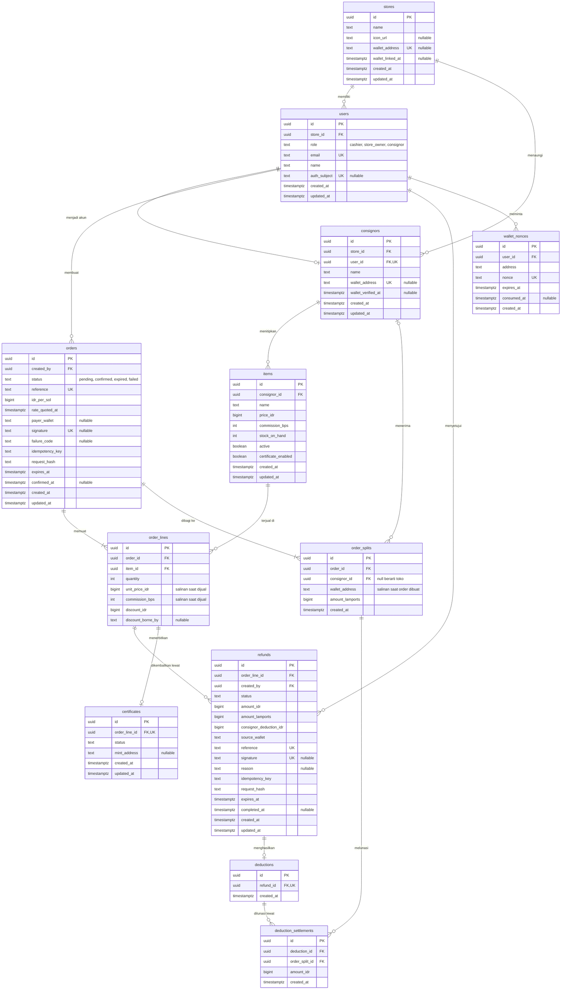

# PRD FastConsignee

Nov 6, 2026
FastConsignee adalah kasir untuk toko konsinyasi: pembeli membayar sekali, lalu bagian tiap penitip dan komisi toko terkirim dalam satu transaksi Solana. Versi hackathon berjalan di Devnet dan harus terkumpul di Devpost sebelum Nov 8, 2026, pukul 21:00 WIB.

## Latar belakang

Banyak pembuat kecil menjual produknya lewat toko orang lain, mulai dari pengrajin dan penjual barang bekas sampai produsen makanan rumahan. Mereka menitipkan barang, toko menjualkannya, lalu toko mengambil komisi. Model konsinyasi ini memberi mereka akses ke pembeli tanpa harus punya toko sendiri.

Masalahnya ada pada alur uang. Hasil penjualan masuk ke toko lebih dulu, dan penitip baru dibayar saat setoran berkala. Selama menunggu, modal mereka sudah tertanam di barang. Mereka juga hanya bisa mengetahui barang yang laku dari laporan toko.

Pemilik toko juga terbebani. Mereka harus menghitung komisi yang berbeda-beda, memisahkan uang milik banyak penitip, dan menyusun laporan satu per satu. Pekerjaan ini menyita waktu dan rawan salah, sementara satu kesalahan kecil bisa merusak kepercayaan.

Kasir biasa belum menyelesaikan akar masalah ini. Laporannya bisa lebih rapi, tetapi uang tetap masuk ke satu pihak lebih dulu. Penitip tetap harus menunggu dan tetap harus percaya.

Solana cocok untuk masalah ini. Satu transaksi bisa memuat beberapa transfer yang berhasil atau gagal bersama-sama, sehingga tidak ada pembayaran yang terbagi setengah jalan. Biayanya rendah untuk penjualan bernilai kecil, konfirmasinya cepat, dan catatannya bisa diperiksa sendiri oleh penitip.

**FastConsignee adalah kasir untuk toko konsinyasi.** Pembeli cukup membayar sekali, lalu bagian tiap penitip dan komisi toko langsung terkirim ke wallet masing-masing dalam satu transaksi. Penitip tidak perlu menunggu setoran, dan toko tidak perlu lagi menghitungnya.

*Every sale, split instantly.*

## Kasus nyata

Masalah ini sudah terjadi di lapangan, baik di luar negeri maupun di UMKM Indonesia. Kasus berikut berasal dari berita dan penelitian publik, bukan wawancara langsung.

| Kasus | Lokasi dan tahun | Yang terjadi | Sumber |
| --- | --- | --- | --- |
| Finders Keepers | Springfield, Missouri, 2025 | Satu keluarga penitip melihat penjualan lebih dari $8.000, tetapi mengaku baru menerima $500. Toko tutup, dan pemiliknya menyatakan bangkrut. | [KY3](https://www.ky3.com/2025/04/17/springfield-consignment-shop-owes-consignors-thousands-dollars-payments-store-is-closing) |
| Picket Fence Market | Bremerton, 2015 | 18 mantan penitip menuntut sekitar $7.000 untuk barang yang sudah terjual. | [Kitsap Daily News](https://kitsapdailynews.com/?p=605) |
| Kue adee | Meureudu, Pidie Jaya, 2026 | Perjanjian titip jual dibuat lisan, dan keterlambatan pembayaran ke produsen menjadi salah satu bentuk wanprestasi. | [Skripsi Universitas Malikussaleh](https://rama.unimal.ac.id/id/eprint/21930/) |
| Lima UMKM makanan dan minuman | Malang, 2021 | Belum adanya dokumen penunjang konsinyasi menaikkan risiko pembayaran tidak lancar. | [Jurnal Administrasi dan Bisnis](https://jurnal.polinema.ac.id/index.php/adbis/article/view/1807) |

Pola yang sama muncul di keempat kasus: uang atau catatan penjualan dipegang satu pihak. Dengan pembagian saat barang terjual, bagian penitip tidak mengendap di toko.

## Problem statement

Penitip di toko konsinyasi baru menerima uangnya saat setoran berkala dan tidak bisa memeriksa penjualannya sendiri, sementara pemilik toko harus menghitung dan memisahkan uang banyak penitip secara manual.

| Pihak | Masalah | Dampak |
| --- | --- | --- |
| Penitip | Hasil penjualan masuk ke toko lebih dulu. | Menunggu setoran berkala, sementara modal tertanam di barang. |
| Penitip | Penjualan hanya diketahui dari laporan toko. | Harus percaya tanpa bisa memeriksa sendiri. |
| Pemilik toko | Komisi berbeda-beda dan uang banyak penitip harus dipisahkan. | Pekerjaan menyita waktu dan rawan salah. |

**Pertanyaan yang dijawab FastConsignee:** bagaimana toko konsinyasi bisa membayar tiap penitip saat barang terjual, dengan catatan yang bisa diperiksa semua pihak, tanpa menambah pekerjaan kasir?

## Tujuan dan alur demo

Tujuan versi hackathon adalah membuktikan satu hal di video: pembeli membayar sekali, lalu saldo semua pihak naik bersamaan. Target utamanya Best Beginner Hack dan sertifikat MLH, sesuai panduan hackathon.

FastConsignee juga dibangun sebagai produk jangka panjang yang menyelesaikan kasus nyata, bukan hanya proyek hackathon. Karena itu fondasi teknisnya disiapkan sejak awal.

Pengumpulan wajib berisi repositori GitHub dan video demo 1–2 menit yang menunjukkan transaksi sukses di Devnet. Urutan videonya:

1. Kasir memasukkan tiga barang dari tiga penitip ke keranjang.
2. Pembeli membayar sekali lewat QR.
3. Layar menampilkan saldo tiga penitip dan toko naik bersamaan.
4. Solana Explorer menunjukkan satu transaksi dengan empat transfer.
5. Satu barang di-refund, lalu potongannya muncul di dasbor penitip.

## User stories: kasir

Kasir menyusun keranjang campuran dan memantau pembayaran sampai terkonfirmasi. Prioritas Wajib berarti story itu harus jalan di video demo.

| ID | User story | Kriteria penerimaan | Prioritas |
| --- | --- | --- | --- |
| K-1 | Sebagai kasir, saya ingin memilih barang dari katalog agar bisa menyusun keranjang tanpa scanner. | Katalog menampilkan nama, harga Rupiah, penitip, dan stok. Barang habis tidak bisa dipilih. | Wajib |
| K-2 | Sebagai kasir, saya ingin satu keranjang memuat barang dari beberapa penitip agar pembeli cukup membayar sekali. | Keranjang menerima barang dari 3–5 penitip. Total berubah saat jumlah barang diubah. | Wajib |
| K-3 | Sebagai kasir, saya ingin melihat rincian pembagian agar bisa memastikan hitungannya benar sebelum pembayaran. | Bagian tiap penitip dan komisi toko tampil terpisah. Jumlah semua bagian sama dengan total keranjang. | Wajib |
| K-4 | Sebagai kasir, saya ingin membuat QR pembayaran dari keranjang agar pembeli bisa membayar lewat wallet. | Tiap order punya reference unik. Nilai QR sama dengan total keranjang. QR kedaluwarsa setelah batas waktu. | Wajib |
| K-5 | Sebagai kasir, saya ingin melihat status pembayaran secara real-time agar tahu kapan barang boleh diserahkan. | Status berubah tanpa refresh: menunggu, terkonfirmasi, kedaluwarsa, atau gagal. Stok direservasi saat order dibuat dan terpotong setelah terkonfirmasi. | Wajib |
| K-6 | Sebagai kasir, saya ingin memberi diskon dan memilih siapa yang menanggungnya agar pembagiannya tetap adil. | Diskon bisa ditanggung toko atau penitip. Rincian pembagian dihitung ulang sebelum QR dibuat. | Sebaiknya |
| K-7 | Sebagai kasir, saya ingin login dengan akun saya agar hanya staf yang bisa membuat order. | Login memakai OAuth. Order tidak bisa dibuat tanpa JWT yang valid. | Wajib |

## User stories: pembeli

Pembeli cukup memindai, menyetujui di wallet, dan menerima bukti pembayaran.

| ID | User story | Kriteria penerimaan | Prioritas |
| --- | --- | --- | --- |
| B-1 | Sebagai pembeli, saya ingin memindai satu QR agar bisa membayar seluruh keranjang sekaligus. | Satu persetujuan di wallet membayar seluruh keranjang. Transaksi berjalan di Devnet. | Wajib |
| B-2 | Sebagai pembeli, saya ingin melihat total dalam Rupiah dan nilai tokennya agar tahu jumlah yang saya bayar. | Layar bayar menampilkan kedua nilai. Kurs dikunci selama QR aktif. | Wajib |
| B-3 | Sebagai pembeli, saya ingin pembayaran batal seluruhnya kalau ada bagian yang gagal agar uang saya tidak tersangkut. | Semua transfer ada dalam satu transaksi. Kalau gagal, tidak ada saldo yang berubah dan layar menawarkan coba lagi. | Wajib |
| B-4 | Sebagai pembeli, saya ingin membayar lewat tombol wallet di browser agar tetap bisa membayar tanpa memindai QR. | Tombol terhubung ke Phantom extension. Transaksinya sama dengan alur QR. | Sebaiknya |
| B-5 | Sebagai pembeli, saya ingin menerima bukti pembayaran agar bisa memeriksa transaksi saya. | Setelah sukses, layar menampilkan daftar barang, total, dan tautan Solana Explorer. | Sebaiknya |
| B-6 | Sebagai pembeli, saya ingin menerima sertifikat keaslian berupa NFT agar kepemilikan barang handmade atau bermerek bisa dibuktikan. | NFT terkirim ke wallet pembeli setelah pembayaran terkonfirmasi. | Kalau sempat |

## User stories: penitip

Penitip menerima uang saat barangnya terjual dan bisa memeriksa sendiri penjualannya.

| ID | User story | Kriteria penerimaan | Prioritas |
| --- | --- | --- | --- |
| P-1 | Sebagai penitip, saya ingin menerima bagian saya saat barang terjual agar tidak perlu menunggu setoran. | Bagian masuk ke wallet penitip dalam transaksi pembayaran yang sama. Jumlahnya sama dengan harga dikurangi komisi. | Wajib |
| P-2 | Sebagai penitip, saya ingin melihat daftar barang saya yang terjual agar tahu hasil penjualannya. | Dasbor hanya menampilkan data penitip itu. Tiap baris memuat barang, tanggal, harga, komisi, dan bagian penitip. | Wajib |
| P-3 | Sebagai penitip, saya ingin memeriksa tiap penjualan di Solana Explorer agar tidak bergantung pada laporan toko. | Tiap baris punya tautan ke transaksinya. Nilai di Explorer sama dengan nilai di dasbor. | Wajib |
| P-4 | Sebagai penitip, saya ingin melihat potongan refund agar tahu alasan penerimaan saya berkurang. | Dasbor menampilkan barang, nilai potongan, dan sisa potongan yang belum lunas. | Wajib |
| P-5 | Sebagai penitip, saya ingin melihat sisa stok barang saya agar tahu kapan harus menambah titipan. | Stok di dasbor sama dengan stok di katalog kasir. | Kalau sempat |
| P-6 | Sebagai penitip, saya ingin login dan menautkan wallet dengan tanda tangan agar hanya saya yang bisa mengubah wallet tujuan pembayaran. | Login memakai OAuth. Wallet tertaut setelah tanda tangan nonce terverifikasi. | Wajib |

## User stories: pemilik toko

Pemilik toko mendapat komisi otomatis dan menangani refund. Data penitip dan barang untuk demo cukup disiapkan sebagai seed.

| ID | User story | Kriteria penerimaan | Prioritas |
| --- | --- | --- | --- |
| T-1 | Sebagai pemilik toko, saya ingin menerima komisi otomatis dari tiap penjualan agar tidak perlu menghitung setoran. | Komisi masuk ke wallet toko dalam transaksi pembayaran yang sama. | Wajib |
| T-2 | Sebagai pemilik toko, saya ingin memproses refund satu barang agar pembeli mendapat uangnya kembali tanpa menunggu penitip. | Refund dikirim dari wallet toko ke wallet pembayar. Bagian penitip tercatat sebagai potongan. | Wajib |
| T-3 | Sebagai pemilik toko, saya ingin potongan refund diambil dari penjualan penitip berikutnya agar dana talangan toko kembali. | Penjualan berikutnya mengurangi bagian penitip sampai potongan lunas. Rincian pembagian menampilkan potongan itu. | Sebaiknya |
| T-4 | Sebagai pemilik toko, saya ingin melihat ringkasan penjualan dan komisi agar tahu kinerja toko. | Dasbor menampilkan total penjualan, total komisi, dan jumlah transaksi. Tiap transaksi tertaut ke Solana Explorer. | Sebaiknya |
| T-5 | Sebagai pemilik toko, saya ingin mengatur barang, harga, dan komisi agar tiap penjualan terbagi sesuai kesepakatan. | Komisi bisa berbeda per barang. Harga dan komisi tersimpan untuk penjualan berikutnya. | Kalau sempat |
| T-6 | Sebagai pemilik toko, saya ingin mendaftarkan penitip dan wallet-nya agar pembayaran sampai ke penerima yang benar. | Alamat wallet divalidasi. Pembayaran memakai SOL, jadi tidak ada token account yang dibuat. | Kalau sempat |
| T-7 | Sebagai pemilik toko, saya ingin akses dibatasi per peran agar kasir dan penitip hanya melihat data yang menjadi haknya. | JWT membuktikan identitas, dan peran dibaca dari akun. API menolak akses antarperan dengan status 403. | Wajib |
| T-8 | Sebagai pemilik toko, saya ingin menautkan wallet toko dengan tanda tangan agar komisi masuk ke wallet yang terbukti milik toko dan refund keluar dari wallet itu. | Wallet tertaut setelah tanda tangan nonce terverifikasi. Dasbor terbuka setelah wallet tertaut. | Wajib |

## User flow

Tiga alur ini menunjukkan urutan layar dan cabang kegagalan utama. Alur lain cukup mengikuti user stories.

### Alur pembayaran


Kedua cabang gagal melepas reservasi stok, lalu kasir membuat QR baru.

### Alur login dan wallet


Pemilik toko dan penitip yang belum menautkan wallet baru bisa masuk dasbor setelah tanda tangannya valid. Wallet toko dipakai untuk menerima komisi dan membayar refund.

### Alur refund


Kalau refund gagal, saldo dan catatan tidak berubah, lalu pemilik toko bisa mencoba lagi.

## Functional requirements

Sistem punya 29 kebutuhan fungsional, dan 20 di antaranya wajib jalan di video demo. Kolom Story menautkan tiap kebutuhan ke user story di atas.

| ID | Area | Kebutuhan | Story | Prioritas |
| --- | --- | --- | --- | --- |
| FR-01 | Katalog | Sistem menampilkan katalog barang dengan nama, harga Rupiah, penitip, dan stok. | K-1 | Wajib |
| FR-02 | Katalog | Sistem menolak barang yang stoknya habis masuk ke keranjang. | K-1 | Wajib |
| FR-03 | Keranjang | Keranjang memuat barang dari hingga 5 penitip dan menghitung ulang total saat jumlah berubah. | K-2 | Wajib |
| FR-04 | Pembagian | Sistem menghitung bagian tiap penitip dan komisi toko berdasarkan komisi per barang, lalu menggabungkannya per penerima. | K-3, T-1 | Wajib |
| FR-05 | Pembagian | Sistem memastikan jumlah semua bagian sama dengan total keranjang, termasuk setelah pembulatan. | K-3 | Wajib |
| FR-06 | Pembagian | Sistem menghitung ulang pembagian saat ada diskon, sesuai pihak yang menanggungnya. | K-6 | Sebaiknya |
| FR-07 | Pembayaran | Sistem membuat order dengan reference unik dan QR Solana Pay Transaction Request. | K-4, B-1 | Wajib |
| FR-08 | Pembayaran | Sistem menampilkan total Rupiah dan nilai token, lalu mengunci kurs selama QR aktif. | B-2 | Wajib |
| FR-09 | Pembayaran | Sistem menyusun semua transfer dalam satu transaksi supaya berhasil atau gagal bersama. | B-1, B-3, P-1, T-1 | Wajib |
| FR-10 | Pembayaran | Sistem memperbarui status menunggu, terkonfirmasi, kedaluwarsa, atau gagal tanpa refresh, dan menawarkan coba lagi saat gagal. | K-5, B-3 | Wajib |
| FR-11 | Pembayaran | Sistem mereservasi stok saat order dibuat, memotongnya setelah pembayaran terkonfirmasi, dan melepas reservasi saat order kedaluwarsa atau gagal. | K-5 | Wajib |
| FR-12 | Pembayaran | Sistem memvalidasi jumlah dan penerima di transaksi sebelum menandai order terkonfirmasi. | K-5, P-1 | Wajib |
| FR-13 | Pembayaran | Sistem menyediakan tombol bayar lewat wallet adapter sebagai alternatif QR. | B-4 | Sebaiknya |
| FR-14 | Pembayaran | Sistem menampilkan bukti pembayaran dengan daftar barang, total, dan tautan Solana Explorer. | B-5 | Sebaiknya |
| FR-15 | Refund | Sistem mengirim refund satu barang dari wallet toko ke wallet pembayar setelah pemilik toko menyetujuinya di wallet. | T-2 | Wajib |
| FR-16 | Refund | Sistem mencatat bagian penitip sebagai potongan dan menampilkannya di dasbor penitip. | T-2, P-4 | Wajib |
| FR-17 | Refund | Sistem memotong bagian penitip di penjualan berikutnya sampai potongan lunas. | T-3 | Sebaiknya |
| FR-18 | Dasbor | Dasbor penitip hanya menampilkan penjualan penitip itu, lengkap dengan barang, tanggal, harga, komisi, bagian, dan tautan Explorer. | P-2, P-3 | Wajib |
| FR-19 | Dasbor | Dasbor pemilik toko menampilkan total penjualan, total komisi, jumlah transaksi, dan tautan Explorer. | T-4 | Sebaiknya |
| FR-20 | Dasbor | Dasbor penitip menampilkan sisa stok yang sama dengan katalog kasir. | P-5 | Kalau sempat |
| FR-21 | Data | Sistem memuat seed data 3 penitip, wallet, barang, harga, dan komisi untuk demo. | T-5, T-6 | Wajib |
| FR-22 | Data | Pemilik toko bisa mengatur barang, harga, dan komisi per barang di aplikasi. | T-5 | Kalau sempat |
| FR-23 | Data | Pemilik toko bisa mendaftarkan penitip, dan sistem memvalidasi alamat wallet-nya. Pembayaran memakai SOL, jadi tidak ada token account. | T-6 | Kalau sempat |
| FR-24 | Sertifikat | Sistem mengirim NFT sertifikat keaslian ke wallet pembeli setelah pembayaran terkonfirmasi. | B-6 | Kalau sempat |
| FR-25 | Auth | Sistem menyediakan login OAuth untuk kasir, pemilik toko, dan penitip. | K-7, P-6, T-7 | Wajib |
| FR-26 | Auth | API memverifikasi JWT dan membatasi akses per peran. Endpoint Solana Pay tetap publik dengan ID order yang tidak bisa ditebak. | K-7, T-7 | Wajib |
| FR-27 | Auth | Sistem menautkan wallet ke akun setelah tanda tangan nonce terverifikasi. | P-6, T-8 | Wajib |
| FR-28 | Pembayaran | Sistem menolak order kalau transfer ke wallet penerima yang kosong bernilai di bawah minimum rent. | B-3 | Wajib |
| FR-29 | Pembayaran | POST /orders memakai idempotency key supaya klik ganda tidak membuat order ganda. | K-4 | Wajib |

## Non-functional requirements

Semua kebutuhan ini berlaku untuk produk, dan urutan pengerjaannya masih diputuskan. Angka targetnya usulan awal dan bisa diubah setelah alur pembayaran diuji di Devnet.

| ID | Kategori | Kebutuhan |
| --- | --- | --- |
| NFR-01 | Performa | Status di layar kasir berubah paling lama 5 detik setelah transaksi terkonfirmasi di Devnet. |
| NFR-02 | Performa | QR muncul paling lama 3 detik setelah kasir menekan checkout. |
| NFR-03 | Akurasi | Perhitungan memakai bilangan bulat pada satuan terkecil token. Selisih terhadap total order harus 0, dan sisa pembulatan masuk ke toko. |
| NFR-04 | Keandalan | Satu order tidak boleh tercatat atau mengurangi stok dua kali. |
| NFR-05 | Keandalan | Alur demo berhasil 5 kali berturut-turut di Devnet sebelum video direkam. |
| NFR-06 | Keamanan | Server tidak menyimpan private key wallet pembeli, penitip, atau toko. |
| NFR-07 | Keamanan | Jumlah dan penerima transaksi dihitung di server, bukan diambil dari data kiriman browser. |
| NFR-08 | Keamanan | Secret dan file environment tidak masuk ke repositori GitHub. |
| NFR-09 | Ketersediaan | Endpoint pembayaran bisa diakses lewat HTTPS publik dari wallet di HP. |
| NFR-10 | Kompatibilitas | Alur QR berjalan di Phantom mobile dalam mode Devnet. |
| NFR-11 | Responsif | Layar bayar dan dasbor penitip bisa dipakai pada lebar layar 375 px. |
| NFR-12 | Keterlacakan | Tiap order menyimpan signature transaksi, dan tautan Explorer mengarah ke cluster Devnet. |
| NFR-13 | Privasi | Nama dan data pribadi tidak ditulis on-chain, karena catatannya bisa dibaca publik. |
| NFR-14 | Jaringan | Aplikasi hanya berjalan di Devnet dan menampilkan label Devnet di layar bayar. |
| NFR-15 | Dokumentasi | README menjelaskan cara menjalankan aplikasi dan menyiapkan wallet Devnet. |
| NFR-16 | Arsitektur | Backend memakai struktur feature-based dengan layer handler, service, dan repository. |
| NFR-17 | Database | Semua foreign key dan kolom yang sering difilter punya indeks. |
| NFR-18 | Database | Query berurutan dalam satu alur berjalan di satu transaksi database, dan transaksi tidak terbuka selama menunggu RPC Solana. |
| NFR-19 | Database | Semua skema dan indeks dikelola lewat migrasi di repositori. |
| NFR-20 | Skalabilitas | API stateless supaya siap berjalan di minimal 2 instance di belakang load balancer. |
| NFR-21 | Skalabilitas | Worker pembayaran aman berjalan di banyak instance tanpa memproses order ganda. |
| NFR-22 | Performa | Kurs, katalog, dan ringkasan dasbor memakai cache di memori Go. Status pembayaran, stok checkout, serta saldo dan potongan penitip tidak di-cache. |
| NFR-23 | Ketersediaan | API menyediakan /healthz untuk health check load balancer. |
| NFR-24 | Keamanan | Rate limit berjalan di memori Go dan membaca IP asli dengan benar. Endpoint yang butuh login dibatasi per akun, Solana Pay per IP dan per order, dan /healthz dikecualikan. Limiter pindah ke Redis saat load balancer aktif. |
| NFR-25 | Kualitas | Test otomatis berjalan di CI. Pembayaran lewat Phantom di HP diuji manual. |
| NFR-26 | Biaya | Semua layanan memakai paket gratis, tanpa biaya sama sekali. |

## Keputusan teknis

Stack sudah ditetapkan dengan biaya nol.

| Area | Keputusan |
| --- | --- |
| Pengerjaan | Solo |
| Pembayaran | SOL di Devnet |
| Frontend | Next.js di Vercel |
| Backend | Go di Render |
| Database | Postgres di Supabase |
| Arsitektur backend | Layered dan feature-based: handler, service, repository |
| Load balancer | Ditunda sampai ada anggaran, API tetap disiapkan stateless |
| Cache | Memori Go lewat interface Cache, diganti Redis saat load balancer aktif |
| Autentikasi | OAuth Google lewat Supabase Auth, JWT diverifikasi API Go |
| Biaya | Nol, hanya memakai paket gratis |
| Hosting API | Satu instance gratis dengan ping cron eksternal setiap 10 menit |
| Kontrak API | OpenAPI 3.1, error RFC 9457, dan lint Redocly serta OWASP |
| Peran | JWT membuktikan identitas, dan peran dibaca dari database supaya pencabutannya langsung berlaku |
| Masa berlaku QR | 5 menit, ditambah masa tenggang 2 menit sebelum order kedaluwarsa dan stok dilepas |
| Batalkan order | Tidak ada endpoint batal, karena QR hanya berlaku sebentar dan stoknya lepas sendiri |
| Stok saat refund | Tidak bertambah otomatis, karena barang yang kembali bisa rusak. Pemilik toko mengubah stok sendiri |
| Nilai refund per unit | Total baris dibagi jumlah barang secara kumulatif, jadi seluruh refund satu baris sama persis dengan yang dibayar |

## Arsitektur sistem


Phantom menerima transaksi dari API Go, lalu mengirimnya langsung ke Solana setelah pembeli menyetujuinya.

Gambar ini adalah arsitektur target. Selama biaya nol, API berjalan di satu instance tanpa load balancer, dan cache berada di memori Go.

## Struktur backend

Tiap fitur punya folder sendiri, dan di dalamnya kode dipisah menjadi handler, service, dan repository.

```text
backend/
  cmd/api/
  cmd/seed/
  migrations/
  internal/
    app/         rute dan worker
    order/       handler.go  service.go  repository.go  model.go
    payment/     handler.go  service.go  repository.go  worker.go
    refund/      handler.go  service.go  repository.go  worker.go
    item/        ...
    consignor/   ...
    dashboard/   ...
    auth/        ...
    seed/        data demo
    testkit/     alat test dan validasi kontrak
    platform/    api, apperr, cache, config, database, middleware, solana
```

- **Handler:** hanya mengurus HTTP, validasi input, dan response.
- **Service:** memegang aturan bisnis dan batas transaksi database.
- **Repository:** hanya berisi query, tanpa aturan bisnis.

## Kontrak API

Kontrak API ditulis dalam OpenAPI 3.1 di [api/openapi.yaml](https://github.com/AldiRachmatdiantoo/FastConsignee/blob/main/api/openapi.yaml), dan mengikat frontend serta backend. Kontrak memuat 28 operasi yang mencakup 28 dari 29 FR. FR-21 tidak punya endpoint karena seed data dimuat lewat skrip.

| Fitur | Endpoint | Peran |
| --- | --- | --- |
| Health | `GET /healthz` | Publik |
| Akun dan wallet | `GET /api/v1/me`, `POST /api/v1/wallet/nonce`, `POST /api/v1/wallet/link` | Semua peran login |
| Barang | `GET` dan `POST /api/v1/items`, `GET` dan `PATCH /api/v1/items/{id}` | Kasir membaca, pemilik toko mengubah |
| Penitip | `GET` dan `POST /api/v1/consignors`, `GET` dan `PATCH /api/v1/consignors/{id}` | Pemilik toko |
| Order | `POST /api/v1/orders/preview`, `GET` dan `POST /api/v1/orders`, `GET /api/v1/orders/{id}`, `GET /api/v1/orders/{id}/status` | Kasir dan pemilik toko |
| Pembayaran | `GET /api/v1/public/orders/{id}`, `GET` dan `POST /api/v1/solana-pay/orders/{id}` | Publik |
| Refund | `POST /api/v1/orders/{id}/refunds`, `GET /api/v1/refunds`, `GET /api/v1/refunds/{id}`, `POST /api/v1/refunds/{id}/signature` | Pemilik toko |
| Dasbor | `GET /api/v1/dashboard/consignor/sales`, `/deductions`, `/stock`, dan `GET /api/v1/dashboard/store/summary` | Penitip dan pemilik toko |

Kontrak mengikuti aturan berikut:

- **Error:** format RFC 9457 dengan `application/problem+json`, ditambah `code` untuk klien dan `request_id` untuk log. Endpoint Solana Pay memakai bentuk sederhana karena dibaca wallet.
- **Idempotency:** buat order dan buat refund wajib memakai header `Idempotency-Key`.
- **Pagination:** daftar memakai cursor, jadi hasilnya stabil walaupun data bertambah.
- **Rate limit:** 120 permintaan per menit per akun, 60 per IP, dan 30 per order. Tiap jawaban memuat header `RateLimit-*`.
- **Uang:** Rupiah dan basis point memakai bilangan bulat, sedangkan lamport dikirim sebagai string supaya presisinya tidak hilang di JavaScript.
- **Batas input:** semua teks, angka, dan daftar punya batas, dan kolom yang tidak dikenal ditolak.
- **Keabsahan:** kontrak lolos lint Redocly dan OWASP API Security dari Spectral tanpa temuan. Pengecualiannya tercatat dengan alasan di `api/.spectral.yaml`.

## Database

Semua query utama wajib punya indeks, dan query berurutan dalam satu alur wajib memakai transaksi.

### Diagram relasi

Database punya 12 tabel dalam bentuk normal ketiga (3NF).



### Tabel

| Tabel | Isi | Aturan penting |
| --- | --- | --- |
| stores | Data toko dan wallet toko | Wallet unik dan baru terisi setelah tanda tangan terverifikasi |
| users | Akun kasir, pemilik toko, dan penitip | Email unik, dan akun dicocokkan lewat `auth_subject` lalu email terverifikasi |
| consignors | Profil penitip dan wallet-nya | Satu akun hanya menjadi satu penitip |
| items | Katalog barang | Harga di atas 0, komisi 0 sampai 10000 bps, stok tidak negatif |
| orders | Kepala order, kurs, dan data pembayaran | `reference` dan `signature` unik, dan kunci idempotency unik per pembuat |
| order\_lines | Barang dalam order | Satu barang hanya sekali per order, dan diskon wajib punya penanggung |
| order\_splits | Penerima dan lamport yang diminta dari transaksi | Satu baris per penerima per order, dan `consignor_id` kosong berarti toko |
| refunds | Refund satu unit barang | Hanya satu refund berjalan per baris order |
| deductions | Potongan yang berlaku setelah refund selesai | Satu potongan per refund |
| deduction\_settlements | Pelunasan potongan dari order berikutnya | Hanya dihitung kalau ordernya `pending` atau `confirmed` |
| certificates | NFT sertifikat keaslian | Satu sertifikat per baris order |
| wallet\_nonces | Nonce penautan wallet | Sekali pakai dan punya batas waktu |

### Relasi

Data keuangan tidak pernah dihapus, jadi semua relasi memakai `RESTRICT`. Hanya nonce yang ikut terhapus, karena tidak punya nilai riwayat.

| Induk | Anak | Kardinalitas | Foreign key | ON DELETE |
| --- | --- | --- | --- | --- |
| stores | users | 1 ke banyak | `users.store_id` | RESTRICT |
| users | consignors | 1 ke 0 atau 1 | `consignors(store_id, user_id)` ke `users(store_id, id)` | RESTRICT |
| stores | consignors | 1 ke banyak | Ikut foreign key komposit di atas | RESTRICT |
| consignors | items | 1 ke banyak | `items.consignor_id` | RESTRICT |
| users | orders | 1 ke banyak | `orders.created_by` | RESTRICT |
| orders | order\_lines | 1 ke 1 atau lebih | `order_lines.order_id` | RESTRICT |
| items | order\_lines | 1 ke banyak | `order_lines.item_id` | RESTRICT |
| orders | order\_splits | 1 ke 1 atau lebih | `order_splits.order_id` | RESTRICT |
| consignors | order\_splits | 0 atau 1 ke banyak | `order_splits.consignor_id` | RESTRICT |
| order\_lines | refunds | 1 ke banyak | `refunds.order_line_id` | RESTRICT |
| users | refunds | 1 ke banyak | `refunds.created_by` | RESTRICT |
| refunds | deductions | 1 ke 0 atau 1 | `deductions.refund_id` | RESTRICT |
| deductions | deduction\_settlements | 1 ke banyak | `deduction_settlements.deduction_id` | RESTRICT |
| order\_splits | deduction\_settlements | 1 ke banyak | `deduction_settlements.order_split_id` | RESTRICT |
| order\_lines | certificates | 1 ke 0 atau 1 | `certificates.order_line_id` | RESTRICT |
| users | wallet\_nonces | 1 ke banyak | `wallet_nonces.user_id` | CASCADE |

### Normalisasi 3NF

- **1NF:** tiap kolom berisi satu nilai. Barang dalam order, penerima, dan pelunasan potongan punya tabel sendiri.
- **2NF:** semua tabel memakai primary key satu kolom, jadi tidak ada kolom yang bergantung pada sebagian key.
- **3NF:** kolom bukan key hanya bergantung pada key tabelnya. Toko dari barang dibaca lewat penitip, toko dari order dibaca lewat pembuatnya, dan email penitip hanya ada di `users`.
- **`consignors.store_id`:** tetap 3NF karena `user_id` unik, sehingga `user_id` juga candidate key. Foreign key komposit memastikan toko penitip sama dengan toko akunnya.

Nilai berikut dihitung saat dibaca, bukan disimpan:

| Nilai | Cara menghitung |
| --- | --- |
| Stok tertahan | Jumlah `quantity` dari order `pending` |
| Stok tersedia | `stock_on_hand` dikurangi stok tertahan |
| Total order, bagian penitip, dan komisi | Fungsi Go dari `order_lines` |
| Jumlah barang yang sudah di-refund | Jumlah refund `completed` per baris order |
| Wallet tujuan refund | `orders.payer_wallet` |
| Nilai potongan | `refunds.consignor_deduction_idr` dari refund yang sudah punya baris `deductions` |
| Sisa potongan dan status lunas | Nilai potongan dikurangi pelunasan pada order `pending` atau `confirmed` |

Kolom berikut terlihat seperti salinan, tetapi sebenarnya fakta milik transaksi itu:

- **`order_lines.unit_price_idr` dan `commission_bps`:** harga dan komisi saat dijual, karena nilai di `items` bisa berubah.
- **`order_splits.wallet_address` dan `amount_lamports`:** yang diminta dari transaksi Solana, karena penitip bisa mengganti wallet.
- **`refunds.source_wallet`, `amount_idr`, `amount_lamports`, dan `consignor_deduction_idr`:** nilai saat refund disusun, karena pemilik toko bisa mengganti wallet.

Stok tertahan sengaja tidak disimpan. Jadi perubahan status order sudah cukup untuk melepas reservasi, dan tidak ada angka reservasi yang bisa berbeda dari order-nya.

### Indeks

| Indeks | Jenis | Fungsi |
| --- | --- | --- |
| users(email), users(auth\_subject) | Unik | Mencocokkan akun Google |
| users(store\_id, id) | Unik | Target foreign key komposit, dan mencari akun per toko |
| stores(wallet\_address), consignors(wallet\_address) | Unik | Satu wallet hanya tertaut ke satu pemilik |
| consignors(user\_id) | Unik | Satu akun hanya menjadi satu penitip |
| consignors(store\_id, created\_at, id) | Biasa | Daftar penitip dan pembatasan data per toko |
| consignors(store\_id, user\_id) | Biasa | Foreign key komposit ke akun |
| items(consignor\_id, active) | Biasa | Katalog dan stok penitip |
| items(name) | GIN trigram | Pencarian nama barang |
| items(created\_at, id) | Biasa | Pagination katalog |
| orders(reference), orders(signature) | Unik | Menemukan order dari transaksi, dan mencegah order tercatat dua kali |
| orders(created\_by, idempotency\_key) | Unik | Mencegah order ganda |
| orders(expires\_at) saat status `pending` | Parsial | Dipakai worker pembayaran |
| orders(created\_by, created\_at, id) | Biasa | Riwayat order dan pagination |
| orders(confirmed\_at) saat status `confirmed` | Parsial | Dipakai dasbor |
| order\_lines(order\_id, item\_id) | Unik | Satu barang hanya sekali per order |
| order\_lines(item\_id) | Biasa | Menghitung stok tertahan |
| order\_splits(order\_id, consignor\_id) | Unik, NULLS NOT DISTINCT | Satu baris per penerima, termasuk toko |
| order\_splits(consignor\_id) | Biasa | Dipakai dasbor penitip |
| refunds(reference), refunds(signature) | Unik | Menemukan refund dari transaksi |
| refunds(created\_by, idempotency\_key) | Unik | Mencegah refund ganda |
| refunds(order\_line\_id) saat status berjalan | Unik parsial | Hanya satu refund berjalan per baris order |
| refunds(order\_line\_id) | Biasa | Foreign key dan jumlah barang yang di-refund |
| refunds(created\_at, id) | Biasa | Daftar refund dan pagination |
| refunds(expires\_at) saat status berjalan | Parsial | Dipakai worker refund |
| deductions(refund\_id) | Unik | Satu potongan per refund |
| deduction\_settlements(deduction\_id, order\_split\_id) | Unik | Satu pelunasan per potongan per penerima |
| deduction\_settlements(order\_split\_id) | Biasa | Foreign key |
| certificates(order\_line\_id) | Unik | Satu sertifikat per baris order |
| wallet\_nonces(nonce) | Unik | Nonce hanya bisa dipakai sekali |
| wallet\_nonces(user\_id) | Biasa | Foreign key |

### Transaksi database

Transaksi database dipakai di tiga alur:

- **Buat order:** menyimpan order, item, pembagian dana, dan reservasi stok.
- **Konfirmasi bayar:** mengubah status dan memotong stok.
- **Refund:** menyimpan refund dan potongan penitip.

Transaksi database tidak bisa membungkus transaksi Solana. Jadi transaksi database tidak boleh tetap terbuka selama menunggu RPC Solana.

Buat order mengunci baris barang dengan urutan ID yang tetap, jadi dua order bersamaan tidak bisa menjual stok terakhir dua kali dan tidak saling deadlock. Worker mengambil order dengan `FOR UPDATE SKIP LOCKED`, supaya tiap order hanya dikerjakan satu proses.

## Load balancer dan caching

Selama biaya nol, API berjalan di satu instance gratis tanpa load balancer. Cron eksternal memanggil /healthz setiap 10 menit supaya layanan tidak tidur. Load balancer Render diperkirakan perlu paket berbayar, jadi API tetap disiapkan agar bisa berjalan di banyak instance.

- **API harus stateless:** tidak ada data sesi di memori instance.
- **Worker tidak boleh memproses order ganda:** tiap instance mengambil order dengan FOR UPDATE SKIP LOCKED.

Cache memakai memori Go lewat interface Cache, supaya bisa diganti Redis saat load balancer aktif.

| Data | Perlakuan |
| --- | --- |
| Kurs SOL/IDR | Cache 30–60 detik |
| Katalog barang | TTL pendek, dihapus saat data berubah |
| Ringkasan dasbor | Cache sekitar 30 detik |
| Status pembayaran | Tidak di-cache |
| Stok saat checkout | Tidak di-cache |
| Saldo dan potongan penitip | Tidak di-cache |

## Testing

Testing mencakup 13 jenis, dan hanya pembayaran lewat Phantom di HP yang dilakukan manual.

| Jenis | Yang diuji | Alat |
| --- | --- | --- |
| Unit | Pembagian, komisi, pembulatan, potongan | Go testing |
| Property dan fuzz | Jumlah bagian selalu sama dengan total | Go fuzzing |
| Repository | Query, indeks, dan transaksi di Postgres sungguhan | Postgres lokal lewat TEST\_DATABASE\_URL |
| Service | Aturan bisnis dengan repository tiruan | Mock atau fake |
| Handler dan API | Status code, validasi, auth | httptest |
| Solana | Isi transaksi dan pembayaran nyata | Local validator, Devnet |
| Kontrak | Endpoint Solana Pay dan API frontend | OpenAPI |
| Concurrency | Dua konfirmasi bersamaan, stok terakhir | go test -race |
| Frontend | Komponen layar | Vitest, Testing Library |
| End-to-end | Alur kasir sampai dasbor | Playwright |
| Beban | API dan load balancer | k6 |
| Keamanan | Celah dependensi, JWT palsu, akses antarperan | gosec, govulncheck |
| Manual | Bayar lewat Phantom di HP | Checklist demo |

## Autentikasi

Kasir, pemilik toko, dan penitip login dengan OAuth, lalu API memakai JWT dengan pembatasan per peran. OAuth memakai Google lewat Supabase Auth, dan API Go memverifikasi JWT yang diterbitkannya.

- **Pembeli tidak login:** pembeli cukup memakai wallet.
- **Endpoint Solana Pay tetap publik:** wallet tidak membawa JWT, jadi URL-nya memakai ID order yang tidak bisa ditebak.
- **Wallet ditautkan dengan tanda tangan:** OAuth hanya membuktikan identitas, bukan kepemilikan wallet. Tanpa ini, akun yang dibobol bisa mengganti wallet tujuan pembayaran.

## Checkpoint kerja

Jadwal ini hanya checkpoint, jadi pekerjaan boleh selesai lebih cepat. Batas amannya Minggu 21:00 WIB.

| Waktu (WIB) | Checkpoint |
| --- | --- |
| Sabtu dini hari | Repo, struktur layer, migrasi dan indeks, deploy pertama, ping cron, lalu uji Transaction Request dengan Phantom di HP |
| Sabtu siang | Inti pembayaran: katalog, keranjang, pembagian dana dan unit test, QR, worker, status |
| Sabtu malam | Supabase Auth, peran, penautan wallet, dasbor penitip |
| Minggu pagi | Refund dan potongan, cache, rate limit, test lanjutan |
| Minggu siang | Uji demo 5 kali, README, rekam video |
| Minggu sore | Submit ke Devpost |

- **Kalau uji Transaction Request belum lolos sampai Sabtu pagi:** pindah ke tombol wallet adapter.
- **Kalau waktunya mepet:** potong load test, cache, dan diskon lebih dulu.

## Backlog

Pekerjaan dicicil per fitur, dan backend dikerjakan lebih dulu. Satu item baru selesai kalau testing-nya lolos, lalu item berikutnya dimulai. Rincian tugasnya ada di [docs/BACKLOG.md](https://github.com/AldiRachmatdiantoo/FastConsignee/blob/main/docs/BACKLOG.md).

| ID | Fitur | Isi | Testing |
| --- | --- | --- | --- |
| B-00 | Fondasi | Konfigurasi, migrasi, error, middleware, /healthz, test harness, CI | Unit, repository, handler, kontrak |
| B-01 | Auth | JWT, akun, peran, penautan wallet, rate limit | Unit, handler, keamanan, kontrak |
| B-02 | Barang | Katalog, ubah barang, stok, cache | Repository, service, handler, kontrak |
| B-03 | Penitip | Daftar, ubah, status wallet | Repository, handler, keamanan, kontrak |
| B-04 | Order | Pembagian, kurs, rincian, buat order, riwayat | Unit, fuzz, repository, concurrency, kontrak |
| B-05 | Pembayaran | Layar bayar, Solana Pay, worker | Unit, service, concurrency, kontrak, Devnet |
| B-06 | Refund | Nilai refund, transaksi, worker, potongan | Unit, property, service, concurrency, kontrak |
| B-07 | Dasbor | Penitip dan pemilik toko | Repository, handler, keamanan, kontrak |
| B-08 | Penutup backend | Seed, dokumentasi, beban, keamanan, Devnet, NFT | Beban, keamanan, Devnet |
| F-01 sampai F-05 | Frontend | Login, kasir, pembeli, dasbor, uji akhir | Vitest, Playwright, manual |

## Keputusan backend

Keputusan ini dibuat saat backend dikerjakan.

| Keadaan | Keputusan |
| --- | --- |
| Transaksi pembayaran memuat instruksi lain | Diterima, karena wallet boleh menambah Compute Budget atau guard. Kumpulan transfer SOL tetap harus persis sama. |
| Transaksi dengan reference order tidak bisa dibaca | Dianggap `VALIDATION_MISMATCH`, supaya stok tidak tertahan selamanya. Ini termasuk versi transaksi yang belum didukung RPC. |
| Signature terlihat, tetapi transaksinya tidak pernah terbaca | Order kedaluwarsa setelah masa tenggang. |
| Order gagal | `signature` dan `payer_wallet` tetap disimpan untuk penelusuran. |
| Satu transaksi dipakai untuk dua order | Order kedua gagal, karena signature unik. |
| Barang nonaktif saat checkout | Ditolak dengan `INSUFFICIENT_STOCK` dan stok tersedia 0. |
| Total order 0 | Ditolak dengan `DISCOUNT_TOO_LARGE`. |
| Nilai satu unit refund 0 lamport | Ditolak dengan `ORDER_NOT_REFUNDABLE`. |
| Masa tenggang refund | Sama dengan masa tenggang order. |
| Urutan barang di keranjang | `order_lines.id` memakai UUIDv7, jadi urutan tersimpan tanpa kolom tambahan. |
| Wallet penitip belum terbukti | Tetap bisa menerima dana, sesuai kontrak. Penitip tanpa wallet ditolak. |
| Akun pemilik toko pertama | Dibuat lewat seed, karena belum ada pendaftaran toko mandiri. |

## Di luar ruang lingkup

Fitur berikut sengaja dilewati supaya inti pembayaran selesai dalam 48 jam:

- Pendaftaran mandiri penitip
- Scanner barcode
- Laporan pajak
- Smart contract custom (Anchor)
- Pembayaran dengan uang sungguhan di mainnet

## Risiko

Risiko terbesar adalah alur Transaction Request, jadi bagian itu diuji paling awal.

| Risiko | Rencana |
| --- | --- |
| Transaction Request butuh endpoint HTTPS publik yang bisa dihubungi wallet di HP. | Deploy dan uji lebih dulu. Cadangannya wallet adapter dengan transaksi split yang sama. |
| Phantom extension tidak bisa memindai QR. | Siapkan Phantom di HP yang diatur ke Devnet. |
| Ukuran transaksi Solana membatasi jumlah penerima. | Batasi 3–5 penitip per keranjang. |
| Transfer SOL bisa gagal kalau wallet penerima kosong dan nilainya di bawah minimum rent. | Isi saldo wallet seed dan tolak order seperti itu (FR-28). |
| Penitip kecil umumnya belum punya wallet kripto. | Siapkan jawaban soal adopsi untuk pitch. |
| Bank Indonesia melarang kripto sebagai alat pembayaran di Indonesia. | Posisikan produk untuk pasar global dan jangan klaim siap dipakai toko di Indonesia. |
| Transaction Request dibuat manual di Go karena library Solana Pay yang kita pakai berbasis JavaScript. | Uji dengan Phantom di HP paling awal. |
| Layanan gratis Render tidur saat idle, sehingga wallet bisa timeout. | Ping /healthz dari cron eksternal setiap 10 menit. Cara ini tidak didukung resmi, dan worker harus bisa melanjutkan order setelah restart. |
| Scope besar untuk solo dalam sekitar 45 jam. | Selesaikan alur pembayaran lebih dulu, lalu ikuti urutan kerja yang diputuskan. |
| Batas paket gratis bisa habis atau berubah, termasuk Render, Supabase, dan RPC Devnet publik. | Cek batasnya di dokumentasi resmi sebelum deploy. |
| Paket gratis Vercel diperkirakan hanya untuk penggunaan non-komersial. | Cek ulang sebelum FastConsignee dipakai secara komersial. |
| Wallet bisa mengirim transaksi setelah masa tenggang, karena wallet mengganti blockhash sendiri. | Masa tenggang 2 menit menutup kasus umum. Kalau dana tetap masuk setelah order kedaluwarsa, pemilik toko mengembalikannya manual. |
| Siapa pun yang tahu reference bisa menerbitkan transaksi sampah, dan order gagal kalau transaksi itu terlihat lebih dulu. | Transaksi sah menang kalau keduanya terlihat pada putaran worker yang sama. Kalau tidak, pemilik toko menanganinya manual. |
| Faucet lewat RPC publik Devnet sudah ditutup. | Ambil SOL Devnet dari faucet web, lalu jalankan uji pembayaran Devnet sebelum demo. |

## Kredit

Landing page dan halaman login memakai [template Linea dari 8B](https://8b.com/templates/linea/) yang gratis, dengan lisensi MIT. Landing page memakai template itu langsung, lalu teks, warna, foto, dan font-nya diganti. Halaman login ditulis ulang di React dengan gaya yang sama.

Tata letak dasbor mengambil contoh dari Datta Able oleh CodedThemes. Itu hanya referensi tampilan, jadi kodenya ditulis sendiri.

Fotonya berasal dari Unsplash. Daftar lengkap foto, font, dan lisensinya ada di [CREDITS.md](frontend/public/landing/CREDITS.md).

Produknya sendiri dibuat untuk proyek ini, yaitu kasir, pembagian dana, refund, dan dasbor.

## Pertanyaan terbuka

Pertanyaan pertama perlu diputuskan sebelum kode backend dipakai untuk pengumpulan.

- [ ] Apakah kode yang dibuat sebelum opening boleh dipakai? Contest Terms MLH untuk Fall 2025 sampai Spring 2026 menyatakan semua pekerjaan harus dilakukan selama acara, dan pekerjaan sebelum acara bisa menggugurkan proyek. Aturan khusus acara ini belum terbaca, jadi kode backend disimpan di branch lokal dan belum di-push.
- [x] Jam berapa batas resminya? Laman MLH menulis pengumpulan awal Minggu 22:00 WIB dan final Minggu 23:45 WIB. Acara dimulai Sabtu 00:00 WIB.
- [ ] Bagaimana mencantumkan penggunaan AI? Panduan aturan MLH mewajibkan penggunaan AI dan framework ditulis rinci di README dan Devpost. Bagian ini perlu disiapkan sebelum submit. Template sudah ditulis di bagian Kredit, sedangkan penggunaan AI belum.
- [x] Dikerjakan solo atau tim? Solo.
- [x] Pembayaran memakai SOL atau USDC? SOL di Devnet.
- [ ] Apakah satu proyek boleh ikut Best Beginner Hack dan DeFi Track sekaligus?
- [x] Apakah nama SplitShelf sudah dipakai pihak lain? Ya, splitshelf.app adalah produk aktif untuk pencatatan konsinyasi, jadi nama produk diganti menjadi FastConsignee.
- [ ] Adakah cerita nyata dari penitip atau pemilik toko untuk memperkuat latar belakang? Kasus publik sudah masuk, tetapi wawancara langsung belum ada.
- [x] Penyedia OAuth memakai Supabase Auth atau dibuat sendiri di Go? Supabase Auth.
- [x] Siap memakai paket berbayar? Tidak, biaya harus nol.
- [x] Load balancer ditunda sampai ada anggaran, atau memakai solusi gratis? Ditunda.
- [x] Layanan cache apa yang dipakai? Memori Go.
- [x] Bagaimana urutan kerjanya? Mengikuti checkpoint kerja, dan boleh selesai lebih cepat.
