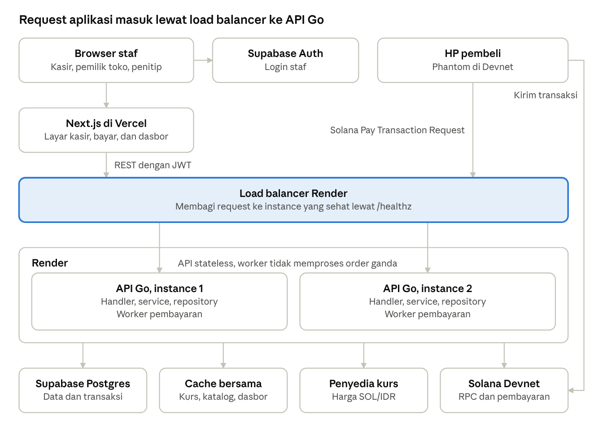
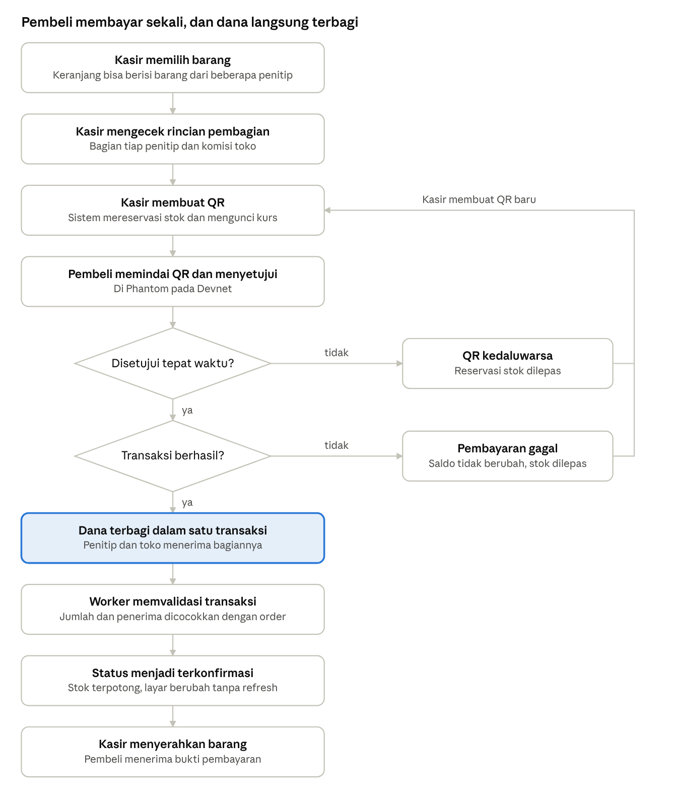
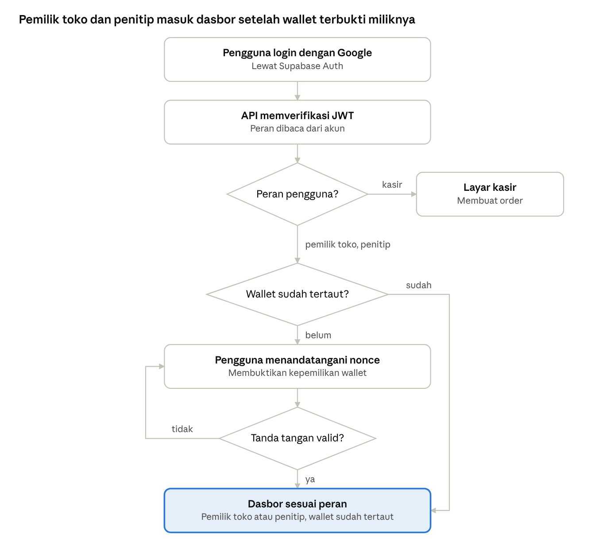
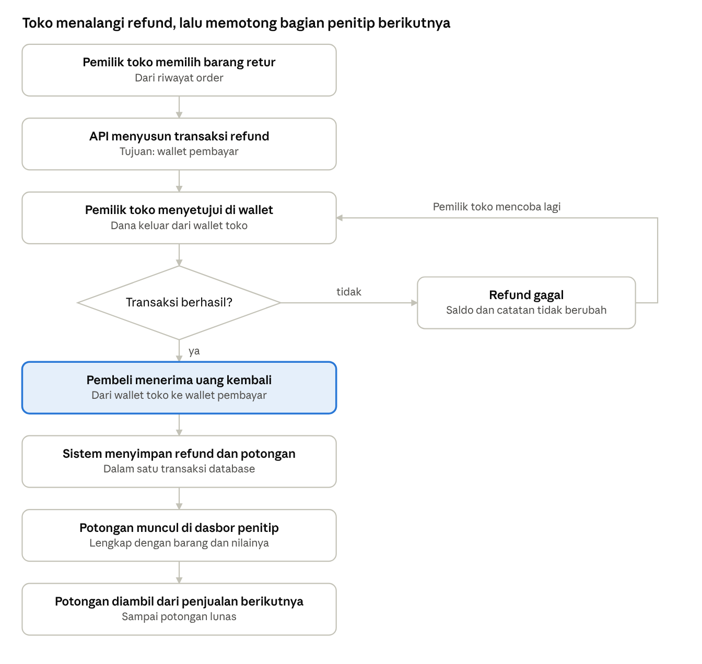
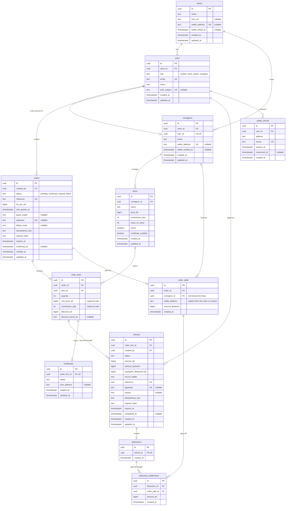

# FastConsignee

A point of sale for consignment shops, built on Solana. The buyer pays once, and every consignor's share and the shop's commission go out in the same Solana transaction.

- **Live app:** https://fast-consignee.vercel.app
- **API health check:** https://fastconsignee-api.onrender.com/healthz (the API serves its endpoints under `/api/v1`, so the bare domain returns 404)
- **Network:** Solana Devnet, so no real money is involved

## The problem

Many small makers sell through someone else's shop: craftspeople, second-hand sellers, home kitchens. They leave their goods, the shop sells them, and the shop takes a commission. The money lands with the shop first, and consignors wait for a periodic settlement. They only know what sold from the shop's report. Shop owners, in turn, juggle different commission rates, keep many consignors' money apart, and write reports by hand.

## How it works

1. **The store owner adds consignors and items**, each item with its own commission rate. The shop and each consignor link a wallet by signing a message, so a stolen login cannot redirect payouts.
2. **The cashier builds a cart** with items from up to five consignors and creates a Solana Pay QR. The SOL rate is locked for that order.
3. **The buyer scans the QR with Phantom and approves once.** One transaction pays every consignor and the shop. Nobody holds the money in between, FastConsignee included. Buyers do not need an account.
4. **The cashier screen confirms on its own**, with a link to the transaction on Solana Explorer.
5. **Consignors check their own sales** on their dashboard instead of asking the shop.
6. **Refunds come from the shop wallet.** The consignor's share of a refund is recorded as a deduction and settled automatically from their next sale.

Example: a bamboo basket sells for Rp 95,000 at a 20% commission. The consignor receives Rp 76,000 and the shop Rp 19,000, in one transaction, converted to SOL at the locked rate.

## Try it

1. Install Phantom, turn on Testnet Mode, and choose Solana Devnet.
2. Get free Devnet SOL from https://faucet.solana.com.
3. Staff sign in with Google. Accounts are registered per store, so a new Google account sees an "account not registered" screen.
4. On a phone, scan the payment QR from Phantom, or open the pay link and tap "Open in the Phantom app".

## Stack

| Area | Choice |
| --- | --- |
| Frontend | Next.js and React on Vercel, Tailwind CSS |
| Backend | Go (`net/http`, `pgx`, `goose`) on Render |
| Database | Postgres on Supabase |
| Sign-in | Google OAuth through Supabase Auth, JWT verified by the Go API, roles read from the database |
| Payments | Solana Pay transaction requests, `@solana/web3.js`, Wallet Adapter, `solana-go` |
| API contract | OpenAPI 3.1 with RFC 9457 errors, linted with Redocly and Spectral |
| Cost | Zero, free tiers only |



Phantom receives the transaction from the Go API and sends it to Solana once the buyer approves. The diagram shows the target architecture. While the project runs at zero cost, the API is a single instance with an in-memory cache.

## Testing

- **Backend:** unit, property, and fuzz tests for the split, commission, rounding, and deductions; repository tests on real Postgres; handler tests with `httptest`; `go test -race` for concurrent confirmations; k6 load tests; `gosec` and `govulncheck`.
- **Frontend:** Vitest and Testing Library for every screen.
- **End to end:** Playwright in Edge and WebKit, from the cashier to the dashboards, including phone sizes.
- **Manual:** paying with Phantom on a phone. The first production payment on Devnet went through on 8 November 2026.

Test results and the work log are in [docs/BACKLOG.md](docs/BACKLOG.md), written in Indonesian.

## Credits

The landing and login pages use the free [Linea template by 8B](https://8b.com/templates/linea/) under the MIT license, with new copy, colors, photos, and fonts. The dashboard layout takes cues from Datta Able by CodedThemes; its code was written from scratch. Photos come from Unsplash. The full list is in [CREDITS.md](frontend/public/landing/CREDITS.md). The product itself, meaning the cashier, the payment split, refunds, and dashboards, was built for this project.

## AI usage

This is a solo project built with help from Claude Code by Anthropic, used to draft the PRD, backlog, and docs, to write and fix backend, frontend, API contract, and test code, and to run the tests and log the results. Product decisions, the stack, design references, and reviewing the results were done by the author. All commits come from the author's account.

---

# Product requirements

Nov 6, 2026
FastConsignee is a cashier for consignment shops: the buyer pays once, and each consignor's share and the shop's commission are sent in one Solana transaction. The hackathon version runs on Devnet and had to be submitted on the MLH submission page by Nov 8, 2026.

## Background

Many small makers sell their products through someone else's shop, from craftspeople and second-hand sellers to home food producers. They leave their goods, the shop sells them, and the shop takes a commission. Consignment gives them access to buyers without running a shop of their own.

The problem is the flow of money. Sales revenue reaches the shop first, and consignors are only paid at periodic settlements. While they wait, their capital is tied up in goods. They also only learn what sold from the shop's report.

Shop owners carry a burden too. They calculate different commission rates, keep many consignors' money apart, and prepare reports one by one. The work takes time and invites mistakes, and one small error can damage trust.

Ordinary cashier software does not fix the root of the problem. Reports may look tidier, but the money still lands with one party first. Consignors still wait, and they still have to trust.

Solana fits this problem. One transaction can hold several transfers that succeed or fail together, so no payment is ever split halfway. Fees are low for small sales, confirmation is fast, and consignors can check the records themselves.

**FastConsignee is a cashier for consignment shops.** The buyer pays once, and each consignor's share and the shop's commission go straight to their own wallets in one transaction. Consignors no longer wait for settlements, and the shop no longer does the math.

*Every sale, split instantly.*

## Real cases

This problem already happens in the field, abroad and among Indonesian small businesses. The cases below come from public news and research, not from direct interviews.

| Case | Place and year | What happened | Source |
| --- | --- | --- | --- |
| Finders Keepers | Springfield, Missouri, 2025 | A consignor family saw more than $8,000 in sales but said they had received only $500. The shop closed, and its owner declared bankruptcy. | [KY3](https://www.ky3.com/2025/04/17/springfield-consignment-shop-owes-consignors-thousands-dollars-payments-store-is-closing) |
| Picket Fence Market | Bremerton, 2015 | 18 former consignors claimed about $7,000 for goods that had already sold. | [Kitsap Daily News](https://kitsapdailynews.com/?p=605) |
| Adee cakes | Meureudu, Pidie Jaya, 2026 | The consignment deal was only verbal, and late payment to the producer was one form of breach. | [Universitas Malikussaleh thesis](https://rama.unimal.ac.id/id/eprint/21930/) |
| Five food and drink businesses | Malang, 2021 | Missing consignment paperwork raised the risk of late payments. | [Jurnal Administrasi dan Bisnis](https://jurnal.polinema.ac.id/index.php/adbis/article/view/1807) |

The same pattern runs through all four cases: one party holds the money or the sales record. When the split happens at the moment of sale, the consignor's share never sits with the shop.

## Problem statement

Consignors only receive their money at periodic settlements and cannot check their own sales, while shop owners calculate and separate many consignors' money by hand.

| Party | Problem | Impact |
| --- | --- | --- |
| Consignor | Sales revenue reaches the shop first. | Waits for periodic settlements while capital is tied up in goods. |
| Consignor | Sales are only known from the shop's report. | Has to trust without being able to check. |
| Shop owner | Commission rates differ, and many consignors' money must be kept apart. | The work takes time and invites mistakes. |

**The question FastConsignee answers:** how can a consignment shop pay each consignor at the moment of sale, with records every party can check, without adding work for the cashier?

## Goal and demo flow

The hackathon version sets out to prove one thing on video: the buyer pays once, and every party's balance rises at the same time. The main targets are Best Beginner Hack and the MLH certificate, following the hackathon guide.

FastConsignee is also built as a long-term product that solves a real problem, not just a hackathon project, so its technical foundation was prepared from the start.

The submission must include the GitHub repository and a 1 to 2 minute demo video showing a successful transaction on Devnet. The video order:

1. The cashier adds three items from three consignors to the cart.
2. The buyer pays once through a QR.
3. The screen shows the balances of three consignors and the shop rising together.
4. Solana Explorer shows one transaction with four transfers.
5. One item is refunded, and the deduction appears on the consignor dashboard.

## User stories: cashier

The cashier builds a mixed cart and follows the payment until it is confirmed. Must priority means the story has to work in the demo video.

| ID | User story | Acceptance criteria | Priority |
| --- | --- | --- | --- |
| K-1 | As a cashier, I want to pick items from a catalog so I can build a cart without a scanner. | The catalog shows name, Rupiah price, consignor, and stock. Out-of-stock items cannot be picked. | Must |
| K-2 | As a cashier, I want one cart to hold items from several consignors so the buyer pays only once. | The cart accepts items from 3 to 5 consignors. The total updates when quantities change. | Must |
| K-3 | As a cashier, I want to see the split breakdown so I can confirm the math before payment. | Each consignor's share and the shop's commission appear separately. All shares add up to the cart total. | Must |
| K-4 | As a cashier, I want to create a payment QR from the cart so the buyer can pay with a wallet. | Each order has a unique reference. The QR amount equals the cart total. The QR expires after a time limit. | Must |
| K-5 | As a cashier, I want to see the payment status in real time so I know when to hand over the goods. | The status changes without a refresh: waiting, confirmed, expired, or failed. Stock is reserved when the order is created and deducted once confirmed. | Must |
| K-6 | As a cashier, I want to give a discount and choose who bears it so the split stays fair. | The shop or the consignor can bear a discount. The split is recalculated before the QR is created. | Should |
| K-7 | As a cashier, I want to sign in with my account so only staff can create orders. | Sign-in uses OAuth. Orders cannot be created without a valid JWT. | Must |

## User stories: buyer

The buyer only scans, approves in the wallet, and gets a receipt.

| ID | User story | Acceptance criteria | Priority |
| --- | --- | --- | --- |
| B-1 | As a buyer, I want to scan one QR so I can pay for the whole cart at once. | One wallet approval pays for the whole cart. The transaction runs on Devnet. | Must |
| B-2 | As a buyer, I want to see the total in Rupiah and in tokens so I know what I am paying. | The pay screen shows both values. The rate is locked while the QR is active. | Must |
| B-3 | As a buyer, I want the whole payment to cancel if any part fails so my money never gets stuck. | All transfers are in one transaction. If it fails, no balance changes and the screen offers to try again. | Must |
| B-4 | As a buyer, I want to pay with a wallet button in the browser so I can pay without scanning a QR. | The button connects to the Phantom extension. The transaction is the same as in the QR flow. | Should |
| B-5 | As a buyer, I want a receipt so I can check my transaction. | After success, the screen shows the items, the total, and a Solana Explorer link. | Should |
| B-6 | As a buyer, I want an NFT certificate of authenticity so I can prove ownership of handmade or branded goods. | The NFT is sent to the buyer's wallet after the payment is confirmed. | Could |

## User stories: consignor

The consignor gets paid when their goods sell and can check their own sales.

| ID | User story | Acceptance criteria | Priority |
| --- | --- | --- | --- |
| P-1 | As a consignor, I want to receive my share when an item sells so I do not wait for a settlement. | The share reaches the consignor's wallet in the same payment transaction. It equals the price minus commission. | Must |
| P-2 | As a consignor, I want to see a list of my items that sold so I know my earnings. | The dashboard only shows that consignor's data. Each row shows the item, date, price, commission, and consignor share. | Must |
| P-3 | As a consignor, I want to check each sale on Solana Explorer so I do not depend on the shop's report. | Each row links to its transaction. The amount on Explorer matches the dashboard. | Must |
| P-4 | As a consignor, I want to see refund deductions so I know why I received less. | The dashboard shows the item, the deduction amount, and any unpaid remainder. | Must |
| P-5 | As a consignor, I want to see the stock left of my items so I know when to bring more. | Dashboard stock matches the cashier catalog. | Could |
| P-6 | As a consignor, I want to sign in and link my wallet with a signature so only I can change where my payouts go. | Sign-in uses OAuth. The wallet is linked after the nonce signature is verified. | Must |

## User stories: shop owner

The shop owner receives commission automatically and handles refunds. Consignor and item data for the demo can be prepared as seed data.

| ID | User story | Acceptance criteria | Priority |
| --- | --- | --- | --- |
| T-1 | As a shop owner, I want to receive commission from every sale automatically so I do not calculate settlements. | The commission reaches the shop wallet in the same payment transaction. | Must |
| T-2 | As a shop owner, I want to refund a single item so the buyer gets their money back without waiting for the consignor. | The refund is sent from the shop wallet to the paying wallet. The consignor's share is recorded as a deduction. | Must |
| T-3 | As a shop owner, I want refund deductions taken from the consignor's next sales so the shop gets its advance back. | Later sales reduce the consignor's share until the deduction is paid off. The split breakdown shows the deduction. | Should |
| T-4 | As a shop owner, I want a summary of sales and commission so I know how the shop is doing. | The dashboard shows total sales, total commission, and the number of transactions. Each transaction links to Solana Explorer. | Should |
| T-5 | As a shop owner, I want to manage items, prices, and commission so each sale splits as agreed. | Commission can differ per item. Prices and commission apply to the next sales. | Could |
| T-6 | As a shop owner, I want to register consignors and their wallets so payments reach the right recipients. | Wallet addresses are validated. Payments use SOL, so no token accounts are created. | Could |
| T-7 | As a shop owner, I want access limited by role so cashiers and consignors only see what they are entitled to. | The JWT proves identity, and the role is read from the account. The API rejects cross-role access with status 403. | Must |
| T-8 | As a shop owner, I want to link the shop wallet with a signature so commission reaches a wallet proven to belong to the shop and refunds leave from it. | The wallet is linked after the nonce signature is verified. The dashboard opens after the wallet is linked. | Must |

## User flow

These three flows show the screen order and the main failure branches. Other flows follow the user stories. The flow diagrams are in Indonesian.

### Payment flow



Both failure branches release the stock reservation, and the cashier creates a new QR.

### Sign-in and wallet flow



Shop owners and consignors who have not linked a wallet can only enter the dashboard after their signature is valid. The shop wallet receives commission and pays refunds.

### Refund flow



If a refund fails, balances and records stay unchanged, and the shop owner can try again.

## Functional requirements

The system has 29 functional requirements, and 20 of them must work in the demo video. The Story column links each requirement to the user stories above.

| ID | Area | Requirement | Story | Priority |
| --- | --- | --- | --- | --- |
| FR-01 | Catalog | The system shows an item catalog with name, Rupiah price, consignor, and stock. | K-1 | Must |
| FR-02 | Catalog | The system keeps out-of-stock items out of the cart. | K-1 | Must |
| FR-03 | Cart | The cart holds items from up to 5 consignors and recalculates the total when quantities change. | K-2 | Must |
| FR-04 | Split | The system calculates each consignor's share and the shop's commission from per-item commission, then groups them per recipient. | K-3, T-1 | Must |
| FR-05 | Split | The system ensures all shares add up to the cart total, including after rounding. | K-3 | Must |
| FR-06 | Split | The system recalculates the split for discounts, based on who bears them. | K-6 | Should |
| FR-07 | Payment | The system creates an order with a unique reference and a Solana Pay Transaction Request QR. | K-4, B-1 | Must |
| FR-08 | Payment | The system shows the Rupiah total and the token amount, and locks the rate while the QR is active. | B-2 | Must |
| FR-09 | Payment | The system puts every transfer in one transaction so they succeed or fail together. | B-1, B-3, P-1, T-1 | Must |
| FR-10 | Payment | The system updates the status (waiting, confirmed, expired, or failed) without a refresh, and offers a retry on failure. | K-5, B-3 | Must |
| FR-11 | Payment | The system reserves stock when the order is created, deducts it once payment is confirmed, and releases the reservation when the order expires or fails. | K-5 | Must |
| FR-12 | Payment | The system validates the amounts and recipients in the transaction before marking the order confirmed. | K-5, P-1 | Must |
| FR-13 | Payment | The system offers a wallet adapter pay button as an alternative to the QR. | B-4 | Should |
| FR-14 | Payment | The system shows a receipt with the items, the total, and a Solana Explorer link. | B-5 | Should |
| FR-15 | Refund | The system sends a single-item refund from the shop wallet to the paying wallet after the shop owner approves it in the wallet. | T-2 | Must |
| FR-16 | Refund | The system records the consignor's share as a deduction and shows it on the consignor dashboard. | T-2, P-4 | Must |
| FR-17 | Refund | The system deducts from the consignor's next sales until the deduction is paid off. | T-3 | Should |
| FR-18 | Dashboard | The consignor dashboard only shows that consignor's sales, with item, date, price, commission, share, and Explorer link. | P-2, P-3 | Must |
| FR-19 | Dashboard | The shop owner dashboard shows total sales, total commission, the number of transactions, and Explorer links. | T-4 | Should |
| FR-20 | Dashboard | The consignor dashboard shows stock left that matches the cashier catalog. | P-5 | Could |
| FR-21 | Data | The system loads seed data with 3 consignors, wallets, items, prices, and commission for the demo. | T-5, T-6 | Must |
| FR-22 | Data | The shop owner can manage items, prices, and per-item commission in the app. | T-5 | Could |
| FR-23 | Data | The shop owner can register consignors, and the system validates their wallet addresses. Payments use SOL, so there are no token accounts. | T-6 | Could |
| FR-24 | Certificate | The system sends an NFT certificate of authenticity to the buyer's wallet after the payment is confirmed. | B-6 | Could |
| FR-25 | Auth | The system provides OAuth sign-in for cashiers, shop owners, and consignors. | K-7, P-6, T-7 | Must |
| FR-26 | Auth | The API verifies JWTs and limits access by role. Solana Pay endpoints stay public with unguessable order IDs. | K-7, T-7 | Must |
| FR-27 | Auth | The system links a wallet to an account after the nonce signature is verified. | P-6, T-8 | Must |
| FR-28 | Payment | The system rejects orders where a transfer to an empty recipient wallet is below the rent minimum. | B-3 | Must |
| FR-29 | Payment | POST /orders uses an idempotency key so a double click does not create two orders. | K-4 | Must |

## Non-functional requirements

These requirements apply to the product, and their order of work was decided along the way. The target numbers were initial proposals that could change after the payment flow was tested on Devnet.

| ID | Category | Requirement |
| --- | --- | --- |
| NFR-01 | Performance | The cashier screen status changes at most 5 seconds after the transaction is confirmed on Devnet. |
| NFR-02 | Performance | The QR appears at most 3 seconds after the cashier presses checkout. |
| NFR-03 | Accuracy | Calculations use integers in the token's smallest unit. The difference from the order total must be 0, and rounding remainders go to the shop. |
| NFR-04 | Reliability | An order must never be recorded or deduct stock twice. |
| NFR-05 | Reliability | The demo flow succeeds 5 times in a row on Devnet before the video is recorded. |
| NFR-06 | Security | The server never stores private keys of buyer, consignor, or shop wallets. |
| NFR-07 | Security | Transaction amounts and recipients are calculated on the server, not taken from browser input. |
| NFR-08 | Security | Secrets and environment files stay out of the GitHub repository. |
| NFR-09 | Availability | Payment endpoints are reachable over public HTTPS from a phone wallet. |
| NFR-10 | Compatibility | The QR flow works in Phantom mobile in Devnet mode. |
| NFR-11 | Responsive | The pay screen and consignor dashboard work at a 375 px screen width. |
| NFR-12 | Traceability | Each order stores the transaction signature, and Explorer links point to the Devnet cluster. |
| NFR-13 | Privacy | Names and personal data are never written on-chain, because the records are public. |
| NFR-14 | Network | The app only runs on Devnet and shows a Devnet label on the pay screen. |
| NFR-15 | Documentation | The README explains how to run the app and set up a Devnet wallet. |
| NFR-16 | Architecture | The backend uses a feature-based structure with handler, service, and repository layers. |
| NFR-17 | Database | Every foreign key and frequently filtered column has an index. |
| NFR-18 | Database | Sequential queries in one flow run in one database transaction, and no transaction stays open while waiting for Solana RPC. |
| NFR-19 | Database | All schema and indexes are managed through migrations in the repository. |
| NFR-20 | Scalability | The API is stateless, ready to run on at least 2 instances behind a load balancer. |
| NFR-21 | Scalability | The payment worker runs safely on many instances without processing an order twice. |
| NFR-22 | Performance | Rates, the catalog, and dashboard summaries use an in-memory Go cache. Payment status, checkout stock, and consignor balances and deductions are never cached. |
| NFR-23 | Availability | The API provides /healthz for load balancer health checks. |
| NFR-24 | Security | Rate limiting runs in Go memory and reads the real client IP correctly. Signed-in endpoints are limited per account, Solana Pay per IP and per order, and /healthz is exempt. The limiter moves to Redis once a load balancer is in place. |
| NFR-25 | Quality | Automated tests run in CI. Paying with Phantom on a phone is tested manually. |
| NFR-26 | Cost | Every service uses a free tier, with no cost at all. |

## Technical decisions

The stack was fixed at zero cost.

| Area | Decision |
| --- | --- |
| Team | Solo |
| Payments | SOL on Devnet |
| Frontend | Next.js on Vercel |
| Backend | Go on Render |
| Database | Postgres on Supabase |
| Backend architecture | Layered and feature-based: handler, service, repository |
| Load balancer | Postponed until there is a budget, with the API kept stateless |
| Cache | Go memory behind a Cache interface, replaced by Redis once a load balancer is active |
| Authentication | Google OAuth through Supabase Auth, JWT verified by the Go API |
| Cost | Zero, free tiers only |
| API hosting | One free instance with an external cron ping every 10 minutes |
| API contract | OpenAPI 3.1, RFC 9457 errors, and Redocly plus OWASP linting |
| Roles | The JWT proves identity, and roles are read from the database so revocation takes effect immediately |
| QR lifetime | 5 minutes, plus a 2-minute grace period before the order expires and stock is released |
| Cancel order | No cancel endpoint, because the QR is short-lived and the stock releases itself |
| Stock on refund | Not restored automatically, because returned goods may be damaged. The shop owner adjusts stock by hand |
| Refund value per unit | The line total divided by quantity, cumulatively, so all refunds on a line add up exactly to what was paid |

## System architecture


Phantom receives the transaction from the Go API and sends it straight to Solana once the buyer approves.

This diagram shows the target architecture. While the project runs at zero cost, the API runs on one instance without a load balancer, and the cache lives in Go memory.

## Backend structure

Each feature has its own folder, and inside it the code is split into handler, service, and repository.

```text
backend/
  cmd/api/
  cmd/seed/
  migrations/
  internal/
    app/         routes and workers
    order/       handler.go  service.go  repository.go  model.go
    payment/     handler.go  service.go  repository.go  worker.go
    refund/      handler.go  service.go  repository.go  worker.go
    item/        ...
    consignor/   ...
    dashboard/   ...
    auth/        ...
    seed/        demo data
    testkit/     test tools and contract validation
    platform/    api, apperr, cache, config, database, middleware, solana
```

- **Handler:** only handles HTTP, input validation, and responses.
- **Service:** holds the business rules and database transaction boundaries.
- **Repository:** only contains queries, with no business rules.

## API contract

The API contract is written in OpenAPI 3.1 in [api/openapi.yaml](https://github.com/AldiRachmatdiantoo/FastConsignee/blob/main/api/openapi.yaml) and binds the frontend and backend. It defines 28 operations covering 28 of the 29 FRs. FR-21 has no endpoint because seed data is loaded by a script.

| Feature | Endpoint | Role |
| --- | --- | --- |
| Health | `GET /healthz` | Public |
| Account and wallet | `GET /api/v1/me`, `POST /api/v1/wallet/nonce`, `POST /api/v1/wallet/link` | Every signed-in role |
| Items | `GET` and `POST /api/v1/items`, `GET` and `PATCH /api/v1/items/{id}` | Cashiers read, shop owners write |
| Consignors | `GET` and `POST /api/v1/consignors`, `GET` and `PATCH /api/v1/consignors/{id}` | Shop owner |
| Orders | `POST /api/v1/orders/preview`, `GET` and `POST /api/v1/orders`, `GET /api/v1/orders/{id}`, `GET /api/v1/orders/{id}/status` | Cashier and shop owner |
| Payment | `GET /api/v1/public/orders/{id}`, `GET` and `POST /api/v1/solana-pay/orders/{id}` | Public |
| Refunds | `POST /api/v1/orders/{id}/refunds`, `GET /api/v1/refunds`, `GET /api/v1/refunds/{id}`, `POST /api/v1/refunds/{id}/signature` | Shop owner |
| Dashboards | `GET /api/v1/dashboard/consignor/sales`, `/deductions`, `/stock`, and `GET /api/v1/dashboard/store/summary` | Consignor and shop owner |

The contract follows these rules:

- **Errors:** RFC 9457 format with `application/problem+json`, plus a `code` for clients and a `request_id` for logs. Solana Pay endpoints use a simpler shape because wallets read them.
- **Idempotency:** creating an order or a refund requires an `Idempotency-Key` header.
- **Pagination:** lists use cursors, so results stay stable as data grows.
- **Rate limits:** 120 requests per minute per account, 60 per IP, and 30 per order. Every response carries `RateLimit-*` headers.
- **Money:** Rupiah and basis points are integers, while lamports are sent as strings so JavaScript keeps full precision.
- **Input limits:** every text, number, and list has a limit, and unknown fields are rejected.
- **Validity:** the contract passes Redocly and Spectral's OWASP API Security lint with no findings. Exceptions are recorded with reasons in `api/.spectral.yaml`.

## Database

Every main query must have an index, and sequential queries in one flow must use a transaction.

### Relationship diagram

The database has 12 tables in third normal form (3NF).



### Tables

| Table | Contents | Key rules |
| --- | --- | --- |
| stores | Shop data and the shop wallet | The wallet is unique and only set after its signature is verified |
| users | Cashier, shop owner, and consignor accounts | Email is unique, and accounts are matched by `auth_subject` and then by verified email |
| consignors | Consignor profiles and their wallets | One account can be only one consignor |
| items | The item catalog | Price above 0, commission 0 to 10000 bps, stock never negative |
| orders | Order header, rate, and payment data | `reference` and `signature` are unique, and the idempotency key is unique per creator |
| order\_lines | Items in an order | Each item appears once per order, and a discount must have a bearer |
| order\_splits | Recipients and the lamports requested in the transaction | One row per recipient per order, and an empty `consignor_id` means the shop |
| refunds | Refund of one item unit | Only one refund in progress per order line |
| deductions | Deductions that apply once a refund completes | One deduction per refund |
| deduction\_settlements | Deductions paid off by later orders | Only counted when the order is `pending` or `confirmed` |
| certificates | NFT certificates of authenticity | One certificate per order line |
| wallet\_nonces | Wallet linking nonces | Single use, with an expiry |

### Relationships

Financial data is never deleted, so every relationship uses `RESTRICT`. Only nonces cascade, because they carry no history.

| Parent | Child | Cardinality | Foreign key | ON DELETE |
| --- | --- | --- | --- | --- |
| stores | users | 1 to many | `users.store_id` | RESTRICT |
| users | consignors | 1 to 0 or 1 | `consignors(store_id, user_id)` to `users(store_id, id)` | RESTRICT |
| stores | consignors | 1 to many | Through the composite foreign key above | RESTRICT |
| consignors | items | 1 to many | `items.consignor_id` | RESTRICT |
| users | orders | 1 to many | `orders.created_by` | RESTRICT |
| orders | order\_lines | 1 to 1 or more | `order_lines.order_id` | RESTRICT |
| items | order\_lines | 1 to many | `order_lines.item_id` | RESTRICT |
| orders | order\_splits | 1 to 1 or more | `order_splits.order_id` | RESTRICT |
| consignors | order\_splits | 0 or 1 to many | `order_splits.consignor_id` | RESTRICT |
| order\_lines | refunds | 1 to many | `refunds.order_line_id` | RESTRICT |
| users | refunds | 1 to many | `refunds.created_by` | RESTRICT |
| refunds | deductions | 1 to 0 or 1 | `deductions.refund_id` | RESTRICT |
| deductions | deduction\_settlements | 1 to many | `deduction_settlements.deduction_id` | RESTRICT |
| order\_splits | deduction\_settlements | 1 to many | `deduction_settlements.order_split_id` | RESTRICT |
| order\_lines | certificates | 1 to 0 or 1 | `certificates.order_line_id` | RESTRICT |
| users | wallet\_nonces | 1 to many | `wallet_nonces.user_id` | CASCADE |

### 3NF normalization

- **1NF:** each column holds one value. Order items, recipients, and deduction settlements have their own tables.
- **2NF:** every table uses a single-column primary key, so no column depends on part of a key.
- **3NF:** non-key columns depend only on their table's key. An item's shop is read through its consignor, an order's shop through its creator, and a consignor's email only lives in `users`.
- **`consignors.store_id`:** still 3NF because `user_id` is unique, which makes `user_id` a candidate key too. The composite foreign key ensures a consignor's shop matches their account's shop.

These values are computed on read, not stored:

| Value | How it is computed |
| --- | --- |
| Held stock | Sum of `quantity` from `pending` orders |
| Available stock | `stock_on_hand` minus held stock |
| Order total, consignor shares, and commission | Go functions over `order_lines` |
| Units already refunded | Count of `completed` refunds per order line |
| Refund destination wallet | `orders.payer_wallet` |
| Deduction amount | `refunds.consignor_deduction_idr` from refunds that have a `deductions` row |
| Remaining deduction and paid status | Deduction amount minus settlements on `pending` or `confirmed` orders |

These columns look like copies, but they are facts that belong to the transaction:

- **`order_lines.unit_price_idr` and `commission_bps`:** the price and commission at sale time, because values in `items` can change.
- **`order_splits.wallet_address` and `amount_lamports`:** what the Solana transaction was asked to pay, because consignors can switch wallets.
- **`refunds.source_wallet`, `amount_idr`, `amount_lamports`, and `consignor_deduction_idr`:** the values when the refund was built, because the shop owner can switch wallets.

Held stock is deliberately not stored. A change in order status is enough to release a reservation, and no reservation count can drift away from its order.

### Indexes

| Index | Type | Purpose |
| --- | --- | --- |
| users(email), users(auth\_subject) | Unique | Matching Google accounts |
| users(store\_id, id) | Unique | Composite foreign key target, and finding accounts per shop |
| stores(wallet\_address), consignors(wallet\_address) | Unique | One wallet links to only one owner |
| consignors(user\_id) | Unique | One account is only one consignor |
| consignors(store\_id, created\_at, id) | Plain | Consignor lists and per-shop data scoping |
| consignors(store\_id, user\_id) | Plain | Composite foreign key to the account |
| items(consignor\_id, active) | Plain | Catalog and consignor stock |
| items(name) | GIN trigram | Item name search |
| items(created\_at, id) | Plain | Catalog pagination |
| orders(reference), orders(signature) | Unique | Finding an order from its transaction, and preventing double recording |
| orders(created\_by, idempotency\_key) | Unique | Preventing duplicate orders |
| orders(expires\_at) where status is `pending` | Partial | Used by the payment worker |
| orders(created\_by, created\_at, id) | Plain | Order history and pagination |
| orders(confirmed\_at) where status is `confirmed` | Partial | Used by dashboards |
| order\_lines(order\_id, item\_id) | Unique | Each item once per order |
| order\_lines(item\_id) | Plain | Computing held stock |
| order\_splits(order\_id, consignor\_id) | Unique, NULLS NOT DISTINCT | One row per recipient, including the shop |
| order\_splits(consignor\_id) | Plain | Used by the consignor dashboard |
| refunds(reference), refunds(signature) | Unique | Finding a refund from its transaction |
| refunds(created\_by, idempotency\_key) | Unique | Preventing duplicate refunds |
| refunds(order\_line\_id) where in progress | Partial unique | Only one refund in progress per order line |
| refunds(order\_line\_id) | Plain | Foreign key and refunded unit counts |
| refunds(created\_at, id) | Plain | Refund lists and pagination |
| refunds(expires\_at) where in progress | Partial | Used by the refund worker |
| deductions(refund\_id) | Unique | One deduction per refund |
| deduction\_settlements(deduction\_id, order\_split\_id) | Unique | One settlement per deduction per recipient |
| deduction\_settlements(order\_split\_id) | Plain | Foreign key |
| certificates(order\_line\_id) | Unique | One certificate per order line |
| wallet\_nonces(nonce) | Unique | A nonce can only be used once |
| wallet\_nonces(user\_id) | Plain | Foreign key |

### Database transactions

Database transactions are used in three flows:

- **Create order:** stores the order, its items, the split, and the stock reservation.
- **Confirm payment:** changes the status and deducts stock.
- **Refund:** stores the refund and the consignor deduction.

A database transaction cannot wrap a Solana transaction, so no database transaction stays open while waiting for Solana RPC.

Creating an order locks item rows in a fixed ID order, so two simultaneous orders cannot sell the last unit twice or deadlock each other. Workers pick orders with `FOR UPDATE SKIP LOCKED`, so each order is handled by one process only.

## Load balancing and caching

While the project runs at zero cost, the API runs on one free instance without a load balancer. An external cron calls /healthz every 10 minutes so the service does not sleep. A Render load balancer likely needs a paid plan, so the API is kept ready to run on many instances.

- **The API must be stateless:** no session data in instance memory.
- **Workers must never process an order twice:** every instance picks orders with FOR UPDATE SKIP LOCKED.

The cache uses Go memory behind a Cache interface, so it can be swapped for Redis once a load balancer is active.

| Data | Treatment |
| --- | --- |
| SOL/IDR rate | Cached 30 to 60 seconds |
| Item catalog | Short TTL, cleared when data changes |
| Dashboard summary | Cached about 30 seconds |
| Payment status | Not cached |
| Stock at checkout | Not cached |
| Consignor balances and deductions | Not cached |

## Testing

Testing covers 13 kinds, and only paying with Phantom on a phone is done by hand.

| Kind | What is tested | Tool |
| --- | --- | --- |
| Unit | Split, commission, rounding, deductions | Go testing |
| Property and fuzz | Shares always add up to the total | Go fuzzing |
| Repository | Queries, indexes, and transactions on real Postgres | Local Postgres through TEST\_DATABASE\_URL |
| Service | Business rules with fake repositories | Mocks or fakes |
| Handler and API | Status codes, validation, auth | httptest |
| Solana | Transaction contents and real payments | Local validator, Devnet |
| Contract | Solana Pay endpoints and the frontend API | OpenAPI |
| Concurrency | Two simultaneous confirmations, the last unit of stock | go test -race |
| Frontend | Screen components | Vitest, Testing Library |
| End to end | From the cashier to the dashboards | Playwright |
| Load | API and load balancer | k6 |
| Security | Vulnerable dependencies, forged JWTs, cross-role access | gosec, govulncheck |
| Manual | Paying with Phantom on a phone | Demo checklist |

## Authentication

Cashiers, shop owners, and consignors sign in with OAuth, and the API uses JWTs with per-role limits. OAuth uses Google through Supabase Auth, and the Go API verifies the JWTs it issues.

- **Buyers do not sign in:** a wallet is all they need.
- **Solana Pay endpoints stay public:** wallets do not carry a JWT, so the URLs use unguessable order IDs.
- **Wallets are linked with a signature:** OAuth only proves identity, not wallet ownership. Without this, a hijacked account could redirect payouts.

## Work checkpoints

This schedule was only a set of checkpoints, so work could finish earlier. The safe deadline was Sunday 21:00 WIB.

| Time (WIB) | Checkpoint |
| --- | --- |
| Early Saturday | Repo, layer structure, migrations and indexes, first deploy, cron ping, then a Transaction Request test with Phantom on a phone |
| Saturday midday | Payment core: catalog, cart, split and unit tests, QR, worker, status |
| Saturday night | Supabase Auth, roles, wallet linking, consignor dashboard |
| Sunday morning | Refunds and deductions, cache, rate limits, more tests |
| Sunday midday | Demo test 5 times, README, record the video |
| Sunday afternoon | Submit on the MLH page |

- **If the Transaction Request test had not passed by Saturday morning:** switch to the wallet adapter button.
- **If time ran short:** cut the load test, the cache, and discounts first.

## Backlog

Work was split by feature, backend first. An item only counted as done once its tests passed, and then the next item started. Task details are in [docs/BACKLOG.md](https://github.com/AldiRachmatdiantoo/FastConsignee/blob/main/docs/BACKLOG.md), written in Indonesian.

| ID | Feature | Scope | Testing |
| --- | --- | --- | --- |
| B-00 | Foundation | Config, migrations, errors, middleware, /healthz, test harness, CI | Unit, repository, handler, contract |
| B-01 | Auth | JWT, accounts, roles, wallet linking, rate limits | Unit, handler, security, contract |
| B-02 | Items | Catalog, item edits, stock, cache | Repository, service, handler, contract |
| B-03 | Consignors | List, edit, wallet status | Repository, handler, security, contract |
| B-04 | Orders | Split, rate, preview, create order, history | Unit, fuzz, repository, concurrency, contract |
| B-05 | Payment | Pay screen, Solana Pay, worker | Unit, service, concurrency, contract, Devnet |
| B-06 | Refunds | Refund value, transaction, worker, deductions | Unit, property, service, concurrency, contract |
| B-07 | Dashboards | Consignor and shop owner | Repository, handler, security, contract |
| B-08 | Backend wrap-up | Seed, docs, load, security, Devnet, NFT | Load, security, Devnet |
| F-01 to F-05 | Frontend | Sign-in, cashier, buyer, dashboards, final tests | Vitest, Playwright, manual |

## Backend decisions

These decisions were made while building the backend.

| Situation | Decision |
| --- | --- |
| The payment transaction contains other instructions | Accepted, because wallets may add Compute Budget or guard instructions. The set of SOL transfers must still match exactly. |
| A transaction with the order reference cannot be read | Treated as `VALIDATION_MISMATCH`, so stock is not held forever. This includes transaction versions the RPC does not support yet. |
| A signature is seen, but its transaction is never readable | The order expires after the grace period. |
| An order fails | `signature` and `payer_wallet` are kept for tracing. |
| One transaction is used for two orders | The second order fails, because signatures are unique. |
| An item is inactive at checkout | Rejected with `INSUFFICIENT_STOCK` and 0 available stock. |
| The order total is 0 | Rejected with `DISCOUNT_TOO_LARGE`. |
| One refund unit is worth 0 lamports | Rejected with `ORDER_NOT_REFUNDABLE`. |
| Refund grace period | Same as the order grace period. |
| Cart item order | `order_lines.id` uses UUIDv7, so the order is kept without an extra column. |
| A consignor wallet is not verified yet | It can still receive funds, per the contract. Consignors without a wallet are rejected. |
| The first shop owner account | Created through the seed, because there is no self-service shop signup yet. |

## Out of scope

These features were skipped on purpose so the payment core could be finished within 48 hours:

- Consignor self-signup
- Barcode scanner
- Tax reports
- Custom smart contracts (Anchor)
- Real-money payments on mainnet

## Risks

The biggest risk was the Transaction Request flow, so it was tested first.

| Risk | Plan |
| --- | --- |
| Transaction Requests need a public HTTPS endpoint a phone wallet can reach. | Deploy and test early. The fallback is the wallet adapter with the same split transaction. |
| The Phantom extension cannot scan QRs. | Prepare Phantom on a phone set to Devnet. |
| Solana transaction size limits the number of recipients. | Limit carts to 3 to 5 consignors. |
| A SOL transfer can fail if the recipient wallet is empty and the amount is below the rent minimum. | Fund the seed wallets and reject such orders (FR-28). |
| Small consignors usually do not have a crypto wallet yet. | Prepare an adoption answer for the pitch. |
| Bank Indonesia bans crypto as a means of payment in Indonesia. | Position the product for global markets and do not claim it is ready for shops in Indonesia. |
| Transaction Requests are built by hand in Go because the Solana Pay library we use is JavaScript-based. | Test with Phantom on a phone first. |
| Render's free tier sleeps when idle, so wallets could time out. | Ping /healthz from an external cron every 10 minutes. This is not officially supported, and workers must resume orders after a restart. |
| Large scope for a solo builder in about 45 hours. | Finish the payment flow first, then follow the agreed order of work. |
| Free tier limits can run out or change, including Render, Supabase, and the public Devnet RPC. | Check the limits in the official docs before deploying. |
| Vercel's free tier is likely meant for non-commercial use only. | Check again before FastConsignee is used commercially. |
| A wallet can send a transaction after the grace period, because wallets refresh the blockhash themselves. | The 2-minute grace period covers the common case. If funds still arrive after an order expires, the shop owner returns them by hand. |
| Anyone who knows the reference can publish a junk transaction, and the order fails if that transaction is seen first. | The valid transaction wins if both are seen in the same worker pass. Otherwise, the shop owner handles it by hand. |
| The Devnet faucet through the public RPC is closed. | Get Devnet SOL from the web faucet, then run a Devnet payment test before the demo. |

Credits and AI usage are listed near the top of this README.

### Main frameworks and libraries

| Area | Used |
| --- | --- |
| Frontend | Next.js, React, Tailwind CSS, `openapi-fetch` |
| Backend | Go, `net/http`, `pgx`, `goose`, `golang-jwt` |
| Solana | `@solana/web3.js`, Solana Wallet Adapter, `qrcode.react`, `solana-go` |
| Sign-in | Supabase Auth with `@supabase/auth-js` |
| API contract | OpenAPI 3.1, Redocly, Spectral |
| Testing | Vitest, Testing Library, Playwright, Newman, axe |

## Open questions

- [ ] May code written before the opening be used? MLH's Contest Terms for Fall 2025 to Spring 2026 say all work must happen during the event, and earlier work can disqualify a project. The event's own rules had not been read yet, so the backend code was kept on a local branch and not pushed.
- [x] What is the official deadline? The MLH page lists an early submission on Sunday 22:00 WIB and a final one on Sunday 23:45 WIB. The event started Saturday 00:00 WIB.
- [x] How should AI use be disclosed? MLH's rules guide requires AI and framework use to be described in detail in the README and on the submission page. Templates are in the Credits section, and AI use is in the AI usage section. Both still need to be copied to the MLH submission page.
- [x] Solo or team? Solo.
- [x] Pay in SOL or USDC? SOL on Devnet.
- [ ] Can one project enter Best Beginner Hack and the DeFi Track at the same time?
- [x] Is the name SplitShelf already taken? Yes, splitshelf.app is an active consignment bookkeeping product, so the product was renamed FastConsignee.
- [ ] Are there real stories from consignors or shop owners to strengthen the background? Public cases are included, but there are no direct interviews yet.
- [x] Supabase Auth or a custom OAuth provider in Go? Supabase Auth.
- [x] Ready to use paid plans? No, the cost must be zero.
- [x] Postpone the load balancer until there is a budget, or use a free option? Postponed.
- [x] Which cache service? Go memory.
- [x] What is the order of work? Follow the work checkpoints, and finishing earlier is fine.
